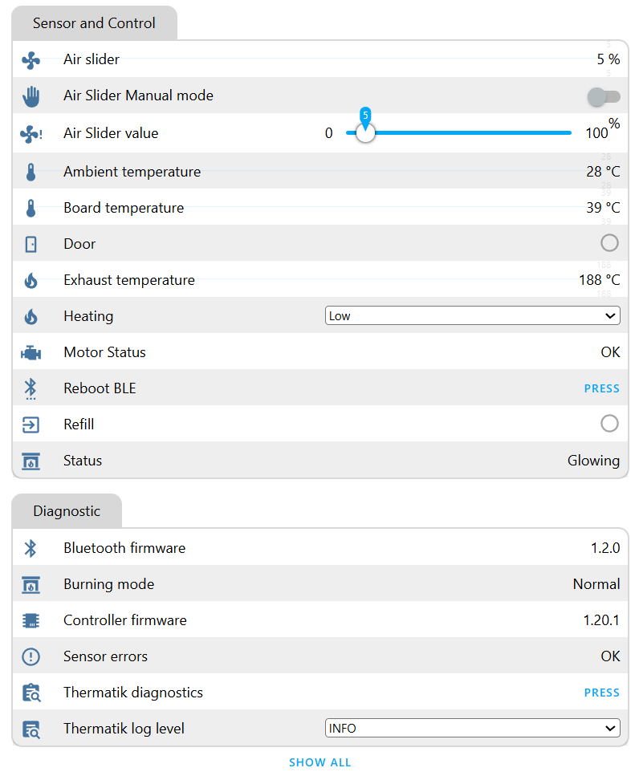

# ESPHome Thermatik Integration

Connect an ESP32 to an **S-Thermatik NEO controller** over BLE and expose its sensors and controls to Home Assistant through your ESPHome API or MQTT configuration.

## Requirements

- An ESP32 supported by ESPHome's BLE client.
- **ESPHome 2026.9.0 or newer.** Package-relative header includes use the upstream fix for [issue #9](https://github.com/vk496/esphome-thermatik/issues/9). No header copies into `/config`, additional Git library, or local-only compilation workaround are needed.

## Installation

Add this package to your ESPHome device configuration:

```yaml
packages:
  thermatik:
    url: https://github.com/vk496/esphome-thermatik
    ref: v1.2.0
    files:
      - path: package.yaml
        vars:
          mac_address: "3C:E0:64:XX:XX:XX"
          # pincode: "000000"
          # fetch_interval: 7s
          # FiringModeAttr: "auto"
```

The package contains the BLE integration. Configure your ESP32 board, network, and API/MQTT separately. Validate and compile the configuration before flashing.

For a local checkout, use `thermatik: !include path/to/esphome-thermatik/package.yaml` under `packages`. All three headers are loaded relative to the package.

## Install with ESPHome Device Builder

1. Update Device Builder to ESPHome **2026.9.0 or newer**. Open your existing ESP32 device, or create one with the wizard and configure its board, Wi-Fi, native API and ESPHome OTA access.
2. Choose **Edit**, add the package snippet above and enter the heater's BLE MAC address and PIN. Use `ref: v1.2.0` for this release. During development, use a local package include with `package.yaml` and its complete `src` directory together.
3. For an older installation, remove the `EsphomeThermatik` Git library override, manually copied headers and corresponding device-level `includes`. Keep your existing network, API and OTA settings.
4. Choose **Validate**, then **Install**. For an ESP32 already running ESPHome with OTA configured, select **Wirelessly**. For the first installation, use the USB option offered by Device Builder; a browser USB install needs a supported browser and a secure page. Selecting **Manual download** provides a firmware file for your existing flashing method.
5. Open **Logs** after installation. Check the controller/Bluetooth firmware, selected heating register and recurring diagnostics. Add the device through Home Assistant's ESPHome integration if it is not already discovered.
6. Enable optional PT/relay entities in Home Assistant's device entity settings. PT1–PT3 are physical inputs: use names matching your installation's probe wiring. **Relay 1/2/3 active** report output bits; **Relay 1/2/3 function** show the controller's configured function. A pump runs from the relay to which it is wired; there is no established universal pump register or fixed relay assignment.

Controls send writes only when requested through their entities. GATT acknowledgement, serialization and fresh register readback remain part of normal operation. The temporary read-only test override was removed in v1.2.0; remove any `thermatik_read_only` substitution left over from pre-release testing.

## Features

- Ambient, board and exhaust temperatures, door/refill status and air-slider readback.
- Controller status and decoded motor/sensor diagnostic flags.
- Automatic heating-register selection from controller firmware: `1C5C` before 1.15.0, `1CBE` from 1.15.0 onward.
- Low/Mid/High heating in normal, automatic operation; manual air-slider control with readback.
- Firmware versions and burning-mode diagnostics.
- Optional PT1–PT3 temperatures for installed water/tank probes, individual relay states and configured relay functions, operating hours, raw relay/sensor flags and initialization diagnostics. Relay states refresh with normal polling; extended diagnostics refresh about once per minute. Unavailable ambient/PT inputs publish unavailable values.
- Immediate queued controls with acknowledged GATT writes and immediate readback; serialized polling, response-length checks and timeout/disconnect recovery.
- Icons for every entity, runtime log verbosity and a diagnostics button.

If automatic register selection needs overriding, set `FiringModeAttr` to `FiringMode_0x1C5C` or `FiringMode_0x1CBE`. Firmware discovery still runs. The heating selector is blocked until the operating mode is known, during manual control, and in TUV/Blue Angel modes. Their special app controls are not implemented.

**Door Remote** sends the app's single Sezam pulse command and is disabled by default. Enable it only for configured Sezam hardware. The old Sezam cover entity was removed because separate open/close/stop commands could not be established. An optional **Save user settings** button is also disabled by default; ordinary control changes do not automatically persist settings.

## Upgrade notes

- Remove manually copied `ble_values.h` files and old `EsphomeThermatik` library overrides from the device configuration. Headers now travel with the package; an old header in the configuration directory can shadow the packaged version.
- Keep ESPHome at 2026.9.0 or newer. Older releases should remain on an older package revision.
- Controller states 4 and 5 now correctly display **Glowing** and **Chamber flush**.
- The ambient temperature is unavailable until sensor-status flags confirm the input exists; this also handles Basic models without that sensor. Signed temperature decoding fixes unsigned wraparound such as `65511` becoming `-25`. No arbitrary temperature is treated as an undocumented sentinel.
- **Sensor Error Count** is now **Sensor Error Flags**. The value is a bitfield, and values such as `7` alone are not home-screen sensor faults in the official app.
- Controls start when the current BLE transaction releases the connection, without waiting for the next polling interval. ADDRESS and DATA writes each require a GATT acknowledgement and the app's 1.2-second settling delay. Heating, manual mode and slider writes request a fresh register read within the same transaction; entities publish the actual controller value. A requested manual-mode change temporarily blocks heating/slider changes until readback confirms the mode.
- Poll intervals trigger complete cycles. A trigger is skipped if the previous cycle is still running; diagnostic cycles can take longer than `fetch_interval`.
- The **Reboot BLE** button disconnects BLE and waits ten seconds before restarting, providing a connection window for the official app.

## Runtime diagnostics

**Controller firmware** and **Bluetooth firmware** are diagnostic text entities. Include both versions and the **Thermatik diagnostics** log output when reporting differences between controllers.

Use **Thermatik log level** to select `INFO`, `DEBUG` or `VERBOSE` without uploading new firmware. `INFO` shows connection/firmware information, warnings and periodic summaries. `DEBUG` adds transaction IDs, GATT acknowledgements, elapsed times and decoded register values; `VERBOSE` also includes raw BLE frames. Read these logs through ESPHome's native API (`esphome logs device.yaml`) or the dashboard. **Thermatik diagnostics** prints current transaction flags, firmware, operating mode and counters on demand; the same summary runs every minute.

Timing substitutions are `ble_write_settle: 1200ms` (official app delay after ADDRESS and DATA writes), `ble_read_settle: 2s` (conservative polling/developer-read delay), and `ble_response_timeout: 3s` (GATT acknowledgement/read timeout). A control can wait for an in-flight read, but does not wait for `fetch_interval`. Pulse/save commands have no invented readback confirmation and are never automatically retried.

## Protocol audit and validation

The supplied ARM32 and ARM64 bundles are both **PROD-2025.11.26**, version code **450**. All **503** distinct register name/address pairs already matched the app. The ARM64 binary has **523** property initializers, including 20 aliases of those same pairs. The audit corrected decoding and transaction behavior and added diagnostics; it does not claim full app parity.

See [the protocol audit](docs/protocol-audit.md) for evidence, register formats, firmware differences, live read observations and remaining limitations. [The retained register inventory](docs/app-registers.json) records each property, format and ARM64 initializer address.

Offline checks require Python, `g++`, and the packages in `tests/requirements.txt`:

```sh
python3 -m pip install -r tests/requirements.txt
python3 -m unittest discover -s tests -v
python3 tools/audit_xapk.py sthermatik_arm64.xapk
```

Tests exercise the actual receiver/control lambdas and GATT writer under address/undefined-behavior sanitizers and generate C++ through both local and remote package imports. The remote-package fixture uses a temporary local Git repository and does not contact a device. The audit tool verifies artifact identity and compares the retained inventory with the header; a different payload requires fresh decompilation.

To extract the audited native payload for further analysis:

```sh
python3 tools/audit_xapk.py sthermatik_arm64.xapk --extract-dir .analysis/re-audit
# With a separately installed dae v0.1.13:
dae .analysis/re-audit/libapp-arm64-v8a.so .analysis/re-audit/decompiled --app --decompile
```

The staged package was compiled and installed wirelessly on the test ESP32 through the existing ESPHome Device Builder using ESPHome 2026.9.1. All 39 exposed entities reported icons, and live relay states/functions, ambient temperature, unavailable PT inputs and runtime logging were checked. Initial live checks used a temporary read-only test image. The v1.2.0 release removes that override and permits normal user-requested controls. No actuator commands were sent. Controller firmware 1.20.1 and Bluetooth firmware 1.2.0 were identified. The write path was tested offline with injected acknowledgements, failures and readback responses; controller acceptance and mechanical behavior remain unverified. Advanced service parameters, relay configuration, certification-mode controls and SUSI configuration remain outside the integration's UI.

## Screenshots




## License

GPLv3. See [LICENSE](LICENSE).
